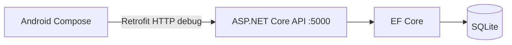

# Kiến trúc hiện tại

Android gọi URL `10.0.2.2:5000` trong Emulator; Backend nghe `0.0.0.0:5000`. Backend quyết định thời gian check-in theo UTC và kiểm tra quyền theo JWT role. Android lấy GPS và chạy BiometricPrompt cục bộ. Token QR là chuỗi ngẫu nhiên một lần, hết hạn sau 5 phút và lưu hash trong database. Phiên Android được mã hóa bằng Keystore và refresh token được xoay khi mở lại app hoặc khi API trả 401.

Backend hiện là một project API theo các file `Auth.cs`, `Business.cs`, `Models.cs`, `SeedData.cs`; chưa tách thành Application/Domain/Infrastructure như yêu cầu ban đầu. Android gồm API client và Compose screen, chưa triển khai MVVM/Hilt/Repository. Đây là giới hạn kiến trúc cần khắc phục.
