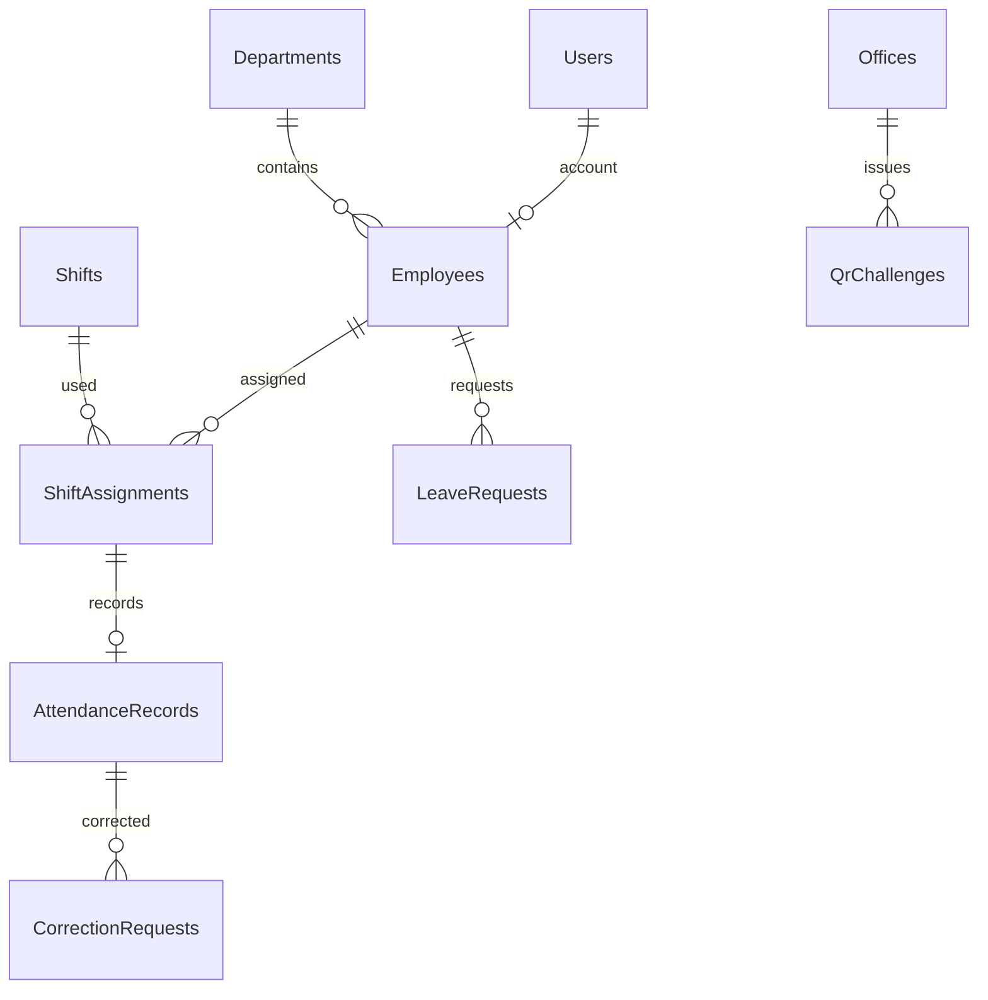

# Thiết kế database hiện tại

EF Core migration: `backend/WorkTrack.Api/Migrations/InitialCreate`. SQLite: `worktrack-v1.db` tại thư mục API.

| Bảng | Khóa và trường chính | Quan hệ / ràng buộc |
|---|---|---|
| Users | Id, Username, Email, PasswordHash, Role, Verified, Active | Unique Username, Email |
| OtpChallenges | Id, UserId, Purpose, Hash, ExpiresUtc, Attempts, UsedUtc | OTP hash |
| RefreshTokens | Id, UserId, Hash, ExpiresUtc, RevokedUtc | Token hash |
| Departments | Id, Code, Name, Description, Active | Unique Code |
| Employees | Id, EmployeeCode, FullName, Email, DepartmentId, UserId | Unique EmployeeCode, UserId; FK Department/User |
| Shifts | Id, Name, StartTime, EndTime, GracePeriodMinutes, Active | Ca có thể qua đêm |
| ShiftAssignments | Id, EmployeeId, ShiftId, WorkDate | Unique EmployeeId + WorkDate |
| Offices | Id, Name, Latitude, Longitude, AllowedRadiusMeters | Tọa độ và bán kính |
| QrChallenges | Id, OfficeId, Hash, ExpiresUtc, UsedUtc | Token một lần |
| AttendanceRecords | Id, EmployeeId, ShiftAssignmentId, CheckInUtc, CheckOutUtc, Late, EarlyLeave | Unique ShiftAssignmentId |
| LeaveRequests | Id, EmployeeId, StartDate, EndDate, Reason, Status | FK Employee |
| CorrectionRequests | Id, AttendanceRecordId, EmployeeId, ProposedCheckOutUtc, Status | FK AttendanceRecord |
| AuditLogs | Id, ActorUserId, Action, Subject, AtUtc | Nhật ký duyệt đơn |

Các bảng Roles, UserRoles, Notifications chưa được tạo. Role hiện là trường trên Users. Cần bổ sung foreign key cho một số bảng và migration tiếp theo trước production.
